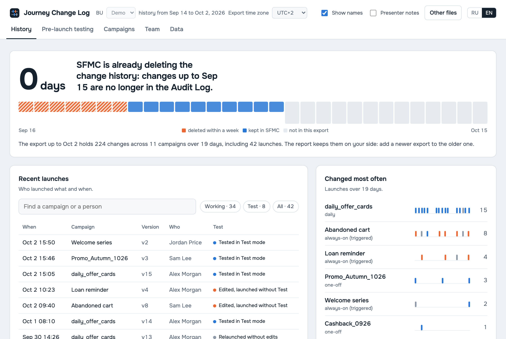
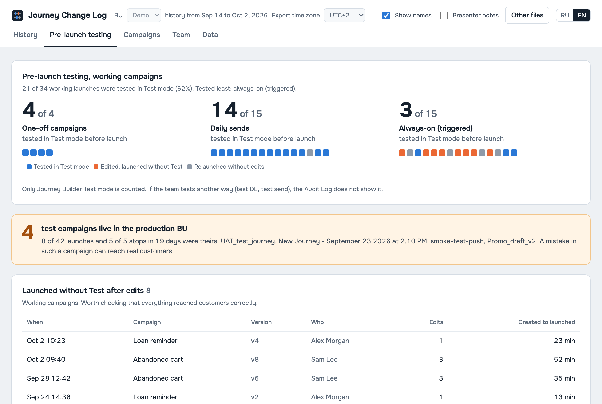
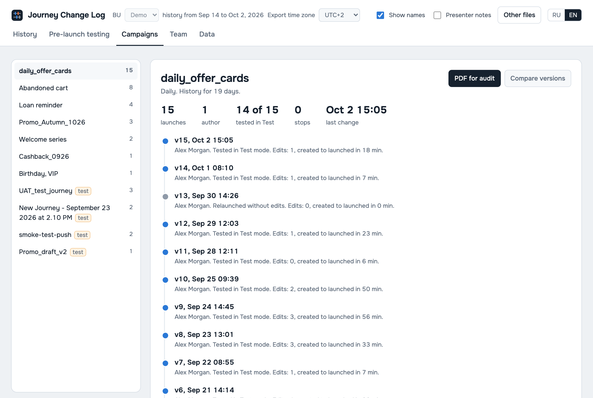
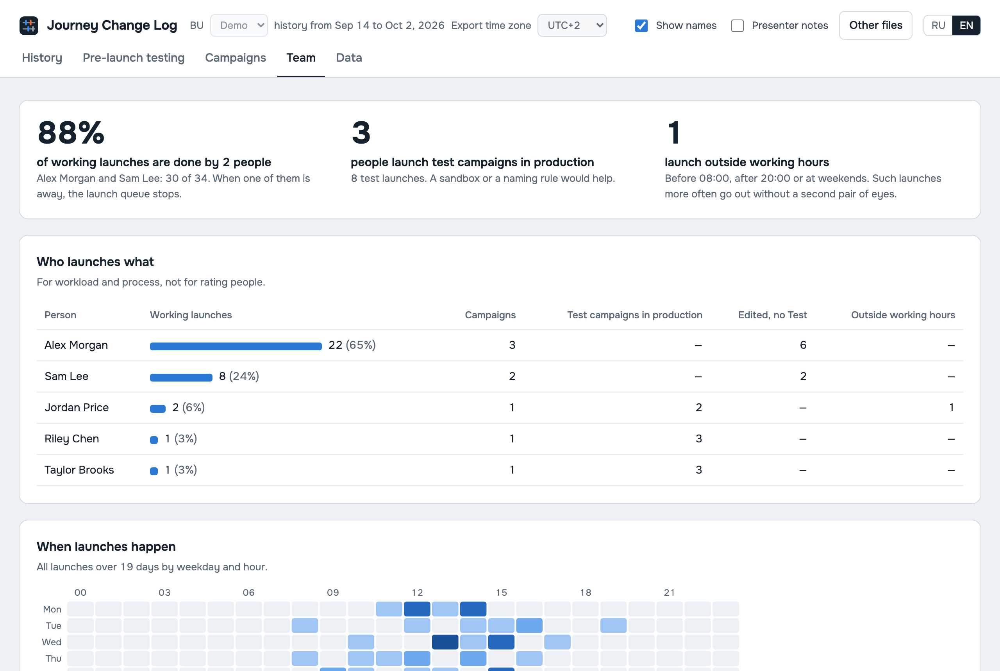
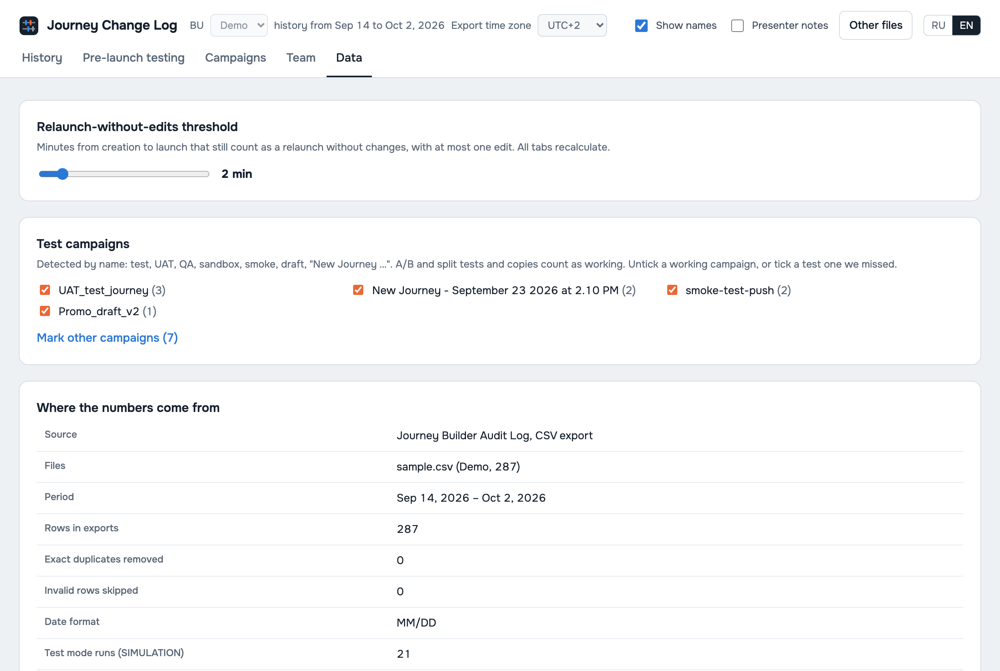

# Journey Change Log for Salesforce Marketing Cloud

An offline, single-file report for **Salesforce Marketing Cloud Engagement (SFMC) Journey Builder**. Drop in a Journey Builder Audit Log export and see who launched which campaign and when, whether each launch was tested in Test mode first, and which test journeys are running in the production business unit.

No install, no server, no network: one HTML file that runs in the browser and never sends your data anywhere.



## Why

SFMC keeps Journey Builder audit history for a limited window, and the Audit Log screen is a flat list of rows. Marketing-ops leads still need answers to a few questions:

- **What changed, and who launched it?** A version swap shows up as several Publish, Unpublish and Modify rows within seconds. The report folds them into one *launch* per activated version.
- **Was it tested before going live?** Journey Builder Test-mode runs appear as `SIMULATION<n> journeyId <versionId>` rows. The report links each run to the version it tested and classifies every launch as *tested*, *edited and launched without Test*, *relaunched without edits*, or *unknown* (created before the export window).
- **Are test journeys running in production?** Journeys named like `UAT_…`, `smoke-test-…`, `QA - …`, `draft` or an untitled `New Journey - …` are flagged and kept out of the headline numbers. A/B and split tests count as real campaigns. Users can override any flag.
- **Is history being lost?** The report shows which part of the export window SFMC has already deleted, and merges overlapping exports so history can be kept outside SFMC.

## Screenshots

All screenshots use the bundled synthetic sample. Every name and ID in it is invented.

| Pre-launch testing | Campaigns |
|---|---|
|  |  |
| **Team** | **Data quality** |
|  |  |

## Use it

1. Download `journey-change-log.html` from the [latest release](https://github.com/valentinatihova/sfmc-journey-change-log/releases/latest) and check it against the published SHA-256.
2. In SFMC: **Journey Builder → Audit Log → Download** (CSV). Several exports, including overlapping ones, can be loaded together; exact duplicates are removed.
3. Open the HTML file and drop the CSV files onto it, or click **See an example** to try it with synthetic data.

The UI is available in English and Russian. MM/DD and DD/MM exports are detected automatically; ambiguous files ask the user which format applies. Exports carry no time zone, so the report asks for one.

## Privacy and security by design

The report is meant to be passed around inside regulated teams such as banks and insurers, so it has to be safe to open:

- **Zero network requests.** The page uses a Content-Security-Policy of `default-src 'none'`. Every inline script and style is allowed only by its SHA-256 hash, and fonts are inlined. An E2E test opens every tab in both languages and fails on any request or CSP violation.
- **Data never leaves the browser.** Files are parsed in memory; nothing is uploaded or stored.
- **Anonymized by default** when a report with embedded data is built for sharing (`--csv`). People become "Specialist N", journeys get generic names and input files become `export-N.csv`; a unit test checks that no input name survives anywhere in the dataset. The `--bu` label is embedded as given.
- **Verifiable build.** Every build writes the SHA-256 of the file next to it, and CI publishes the hash in the artifact name.
- **Errors without leaking content.** Wrong or broken files produce named errors (`WRONG_FILE`, `AMBIGUOUS_DATE`, `MIXED_DATE_FORMATS`, …). Diagnostics report header shape only, never cell contents.

## How it works

```
Audit Log CSV(s) ─► parseCsv ─► header check ─► detect date order ─► events (naive local time)
   ─► dedupe across files ─► split SIMULATION (Test-mode) runs ─► one record per activated version
   ─► classify: tested | edited | relaunched without edits | unknown ─► metrics ─► Dataset
                                                                                  │
template.html (render, RU/EN) + inlined core + Onest font + CSP hashes ◄──────────┘
   = dist/journey-change-log.html (single file, ~190 KB with fonts)
```

| Path | What |
|---|---|
| `src/core.ts` | Pure logic with no DOM, network or time-zone handling: parsing, deduplication, Test-run linking, classification, metrics |
| `src/template.html` | Rendering and interaction (tabs, filters, BU switch, per-journey test overrides, presenter notes) |
| `src/build.ts` | Inlines core (TypeScript types stripped), fonts and sample; generates CSP hashes and SHA-256 |
| `src/gen-sample.ts` | Deterministic synthetic exports in the real SFMC format (`bank`, `retail`, `agency` profiles) |
| `tests/e2e/` | Playwright tests of the built file |

## Develop

Requires Node.js 24+ (TypeScript runs natively through type stripping).

```bash
npm ci
npx playwright install chromium
npm run check      # typecheck, 24 unit tests, build, 5 E2E tests
```

```bash
npm run build                                         # dist/journey-change-log.html (drop mode)
npm run samples                                       # synthetic bank/retail/agency exports → samples/
node src/gen-sample.ts --profile agency --seed 2 --out x.csv
node src/build.ts --csv a.csv --csv b.csv --bu "Main BU" --out report.html   # anonymized embedded report
```

CI runs typecheck, unit tests, build and E2E on every push, plus gitleaks secret scanning.

## Context

This report is the first, offline module of **SFMC Campaign Ops Analytics**, a product I'm developing (in discovery). It measures campaign lead time, rework and team workload from SFMC audit events, delivered as a Marketing Cloud App. This repository was extracted from that private product repository as the open-source part.

Author: [Valentina Tihova](https://github.com/valentinatihova), Data & MarTech Architect (Salesforce Marketing Cloud, Data Cloud).

## License

[MIT](LICENSE). The bundled Onest font is licensed under the SIL Open Font License 1.1 (see `src/fonts/README.md`).

Salesforce, Marketing Cloud and Journey Builder are trademarks of Salesforce, Inc. This project is not affiliated with or endorsed by Salesforce.
